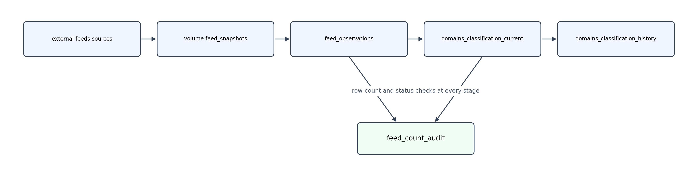

# pb_threat_protection_daily_job

## Getting Started (workspace UI)

The simplest path: clone this repo into your workspace and do everything from the **Deployments** panel — no CLI or local clone required.

1. **Clone the repo** into your workspace (Git folder / Files in workspace).
2. **Deploy** — click the **deployment rocket** 🚀 in the left sidebar to open the **Deployments** panel, then click **Deploy**. It deploys to the `dev` target of the workspace you are currently in (no host is hardcoded). If your catalog/schema differ from the defaults, set **variable overrides** in the panel instead of editing the YAML.
3. **Run the config job ONCE** — hover over `pb_threat_protection_config` in the panel and click **Run**. It creates the schema, the `feed_snapshots` volume, and all four Delta tables. The daily job fails without this step.
4. **Run the daily job** — hover over `pb_threat_protection_daily_job` and click **Run**.

## Daily Pipeline Lineage

Notebooks live in `src/pb_threat_protection_daily_job/`.

### `pb_threat_protection_config` (one-time setup job)

* **`00_configuration`** creates:
    - schema `workspace.pb_threat_intelligance` (by default, but can be parameterized),
    - volume `feed_snapshots` for storing raw source files,
    - and tables:
        - `feed_observations` for parsed inputs from all feeds together,
        - `feed_count_audit` for processing logs (stage/status/counts),
        - `domains_classification_current` for stroing current domains' categories,
        - `domains_classification_history` for archiving historical domains' categories.

### `pb_threat_protection_daily_job` (daily processing)

1. **`Download_snapshot`** downloads the four threat feeds into `/Volumes/{catalog}/{schema}/feed_snapshots/{YYYYMMDD}/{run_id}/`.
Where `run_id` = `HHMMSSZ_<uuid8>`, shared by all feeds in the run. **Important:** Operates on all-or-nothing rule meaning any failed feed download aborts the run.
2. **`Parse_domains`**  parses hosts/adblock lines and classifies each line as `accepted domain` / `IP` / `wrong format` (domains not meeting the DNS standards) and stores data to `feed_observations` and counts per feed `feed_count_audit`.
3. **`Build_current_states`** keeps only `accepted domain` rows of the run (fillters out IPs and domains not meeting the DNS format), normalizes domains (lowercase, trim, strip trailing dot), maps each to its broadest **existing** ancestor (`www.<n>.`, `www2.<n>.` stripped only when the parent exists), dedupes, and resolves category conflicts by priority (malware first). Rewrites `domains_classification_current` to store only the latest state per domain and appends logs to `feed_count_audit`.
4. **`Archive_history`** merges the new current state into `domains_classification_history` as SCD Type 2 (`valid_from` / `valid_to` / `is_current` / `closed_by_run_id`).

### Daily pipeline data flow

### Open points:

* Full category priority order beyond "malware first":
* Retention policy for old `feed_snapshots` (if any):
* Intended schedule + timezone for the daily job
* Notification on failure/long processing time etc.

## Documentation

- For information on using **Declarative Automation Bundles in the workspace**, see: [Declarative Automation Bundles in the workspace](https://docs.databricks.com/aws/en/dev-tools/bundles/workspace-bundles)
- For details on the **Declarative Automation Bundles format** used in this bundle, see: [Declarative Automation Bundles Configuration reference](https://docs.databricks.com/aws/en/dev-tools/bundles/reference)
