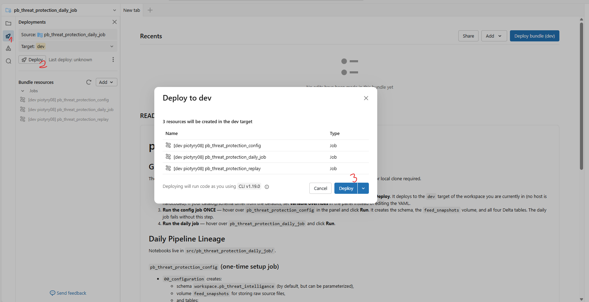

# User manual

###### Prerequisits:
- Logged-in databricks subsricption or free edition account

##### Step-by-step instruction:

1. Create `Git Folder` within your Workspace using this GitHub repo link: https://github.com/Piotr-Barnas/pb-threat-protection.git
2. Go to: `./pb-threat-protection/pb_threat_protection_daily_job`
3. Click `open in editor` button
4. Deploy the bundle by clicking:
    1. Deployments section on side-bar (rocket sign)
    2. Deploy sign (leave source and target as `prod` -  it's fine for this task without real code life-cycle principles)
    3. Deploy

    
5. Go to `Jobs & Pipelines` section
6. Open `pb_threat_protection_config` job
7. (optional) Setup job parameters before executing, by clicngin `Run now with different settings`. The parameters will determine target location for volume and tables used in main pipeline:
    - catalog (by default workspace)
    - schema (by default pb_threat_intelligence)
**Important:** if parameters changed, please remember to setup accordingly on further processing steps (step 10. and testing queries)
8. Click `Run now`. Wait for the job to finish with `Succeeded` status. It should take around 1 minute
9. Afterwards, go back to `Jobs & Pipelines` section.
10. Choose depending on preferences / run purpose. If you want to run:
    - **full daily pipeline** on the actuall feeds' data sources - go to `pb_threat_protection_daily_job` and run it
    - **test pipeline** on saved input snapshots - go to `pb_threat_protection_replay` and run it